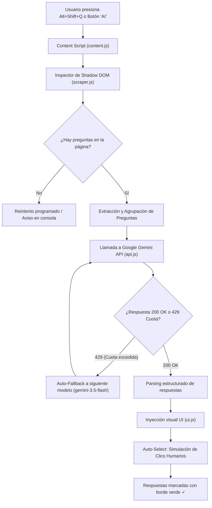

# Documentación Oficial: NetAcad Assistant

**NetAcad Assistant** es una extensión de navegador construida bajo el estándar **Manifest V3** de Chromium, diseñada para asistir en la resolución de cuestionarios y evaluaciones dentro de las plataformas educativas de Cisco (**Cisco NetAcad** y **SkillsForAll**).

La herramienta analiza automáticamente el contenido del examen (incluso dentro de *iframes* y componentes encapsulados en *Shadow DOM*), consulta a los modelos de inteligencia artificial de **Google Gemini** mediante una única petición agrupada (*batch request*) y selecciona las respuestas correctas de forma inmediata y automática en la pantalla.

---

## 1. Arquitectura y Cómo Funciona por Dentro

El sistema opera a través de cinco etapas coordinadas entre los scripts del navegador y la API de Gemini:



### 1.1. Inspección Profunda de Shadow DOM
Cisco utiliza el framework *Adapt Learning*, el cual encapsula cada elemento del curso dentro de Web Components cerrados:
- Etiqueta raíz: `<app-root>`
- Contenedor de página: `<page-view>`
- Bloques de contenido: `<article-view>` y `<block-view>`
- Componentes de preguntas: `<mcq-view>` (preguntas de opción única y múltiple) y `<object-matching-view>` (preguntas de emparejar/unir).

El archivo [scraper.js](file:///c:/Users/Snooze/Documents/testProgramas/netacad-autoanswer/scraper.js) atraviesa recursivamente estos árboles de Shadow DOM para extraer el texto de la pregunta y todas las opciones disponibles.

### 1.2. Agrupación por Lotes (*Batching*)
En lugar de hacer una petición a la API por cada pregunta (lo que saturaría rápidamente tu cuota de red y aumentaría la latencia), [api.js](file:///c:/Users/Snooze/Documents/testProgramas/netacad-autoanswer/api.js) toma **todas las preguntas de la página actual**, las estructura en un único array JSON y las envía en una sola llamada a Gemini con salida tipada (`responseMimeType: "application/json"`).

### 1.3. Auto-Marcado Seguro (*Auto-Select*)
Una vez recibida la respuesta:
1. El script normaliza el texto de las opciones (remueve espacios redundantes, viñetas, letras A/B/C/D y etiquetas HTML).
2. Empareja la sugerencia de la IA con el elemento exacto en la página.
3. Despacha una secuencia completa de eventos de ratón (`pointerover` → `mouseover` → `pointerdown` → `mousedown` → `pointerup` → `click`) sobre el elemento `<label>` y el `<input>` (`radio` o `checkbox`).
4. Para preguntas de emparejar (*matching*), hace clic primero en la opción de origen y luego en la categoría de destino con una pausa imperceptible.
5. Agrega un borde verde y el distintivo `✓ Auto-marcada` para que identifiques qué se seleccionó.

### 1.4. Sistema de Resiliencia ante Cuota (Auto-Fallback para Error 429)
Google Gemini en su capa gratuita impone un límite de **500 peticiones por día por cada modelo**.
Si el modelo configurado alcanza ese límite (Error 429 `RESOURCE_EXHAUSTED`):
- El sistema detecta el código `429`.
- **Cambia automáticamente** al siguiente modelo disponible (`gemini-3.5-flash-lite` → `gemini-3.5-flash` → `gemini-3.1-flash-lite`).
- Guarda el nuevo modelo activo en el almacenamiento local para que las siguientes preguntas continúen sin interrupciones.

---

## 2. Requisitos Previos

- Cualquier navegador basado en **Chromium**:
  - Google Chrome (versión 100 o superior).
  - Microsoft Edge.
  - Brave Browser.
  - Opera / Vivaldi.
- Una **API Key de Google Gemini**:
  - Tu extensión ya viene con una clave preconfigurada y lista para usar.
  - Si deseas generar una clave propia adicional, puedes obtenerla gratis en [Google AI Studio](https://aistudio.google.com/app/apikey).

---

## 3. Guía de Instalación Paso a Paso

Sigue estos pasos para cargar la extensión en tu navegador:

1. **Abre el administrador de extensiones:**
   - En **Google Chrome / Brave**: escribe en la barra de direcciones `chrome://extensions/` y presiona Enter.
   - En **Microsoft Edge**: escribe `edge://extensions/`.
2. **Habilita el Modo de desarrollador:**
   - Activa el interruptor **"Modo de desarrollador"** (*Developer mode*) ubicado en la esquina superior derecha.
3. **Carga la carpeta del proyecto:**
   - Haz clic en el botón **"Cargar descomprimida"** (*Load unpacked*) en la esquina superior izquierda.
   - En la ventana de selección de archivos, dirígete a:
     ```text
     c:\Users\Snooze\Documents\testProgramas\netacad-autoanswer
     ```
   - Haz clic en **Seleccionar carpeta**.
4. **Verificación:**
   - Verás la tarjeta de la extensión **NetAcad Scraper** versión 1.0 activa.
   - *(Recomendado)* Haz clic en el icono del rompecabezas 🧩 en la barra de extensiones del navegador y **fija el icono** de NetAcad Assistant para tenerlo visible.

> [!TIP]
> Cada vez que se realice un cambio en el código fuente, solo debes ir a `chrome://extensions/` y presionar el botón de **recargar (la flecha circular 🔄)** en la tarjeta de la extensión.

---

## 4. Manual de Uso Diario

Cuando estés realizando una lección, laboratorio o examen en NetAcad o SkillsForAll:

### Método 1: Atajo de teclado (El más rápido y recomendado)
1. Entra a la página del examen o cuestionario.
2. Presiona:
   - **`Alt + Shift + Q`** en Windows / Linux.
   - **`Option + Shift + Q`** en macOS.
3. En aproximadamente 1 segundo, la IA resolverá todas las preguntas visibles y marcará automáticamente las casillas correctas.

### Método 2: Botón flotante "AI"
1. Al ingresar a cualquier página de NetAcad verás un botón circular azul con el texto **`AI`** al costado izquierdo.
2. Puedes **hacer clic sobre él** para procesar la página.
3. Puedes **arrastrarlo** a cualquier posición de la pantalla si te estorba la visualización de una imagen o diagrama.

### Método 3: Menú emergente (Popup)
1. Haz clic en el icono de la extensión en la barra de herramientas.
2. Presiona el botón verde **"Process Questions on this Page"**.

> [!IMPORTANT]
> **El botón de enviar examen permanece siempre bajo tu control manual.** La extensión responderá y marcará todas las preguntas de la prueba, pero tú decides el momento exacto en el que deseas hacer clic en *Submit Assessment* o *Finalizar Examen*.

---

## 5. Panel de Ajustes (Popup)

Al hacer clic en el icono de la extensión podrás ajustar las siguientes opciones:

| Opción | Estado por Defecto | Descripción |
| :--- | :---: | :--- |
| **Gemini API Key** | Preconfigurada | Tu clave de acceso a la API de Google Gemini. |
| **Gemini Model** | `gemini-3.5-flash-lite` | Modelo de IA seleccionado para inferencia. |
| **Show AI Answers** | `Activado` | Muestra un cuadro azul debajo de la pregunta con el desglose del análisis de la IA. |
| **Auto-select Answers** | `Activado` | Si está activo, hace clic automáticamente en las respuestas. Si lo desactivas, solo muestra el texto como sugerencia. |
| **Process on Page Switch** | `Activado` | Detecta si cambiaste de diapositiva o bloque y analiza el nuevo contenido. |

---

## 6. Solución de Problemas Frecuentes (FAQ)

### ¿Qué hago si aparece el "Error 429: Quota exceeded"?
- **Causa:** Has superado las 500 solicitudes gratuitas diarias que Google otorga por modelo.
- **Solución automática:** El sistema cambiará por sí solo al siguiente modelo (`gemini-3.5-flash`).
- **Solución manual:** Abre el menú popup de la extensión, cambia el selector **Gemini Model** a `gemini-3.5-flash` o `gemini-3.8-flash` y presiona **Save Settings**. También puedes ingresar una API Key secundaria si tienes otra cuenta de Google.

### Presiono el atajo y dice "No questions found on page"
- Asegúrate de que el cuestionario haya terminado de cargar sus componentes en pantalla. Si la página muestra un círculo de carga o la barra de progreso de Cisco, espera 2 segundos y presiona `Alt + Shift + Q` nuevamente.

### Las opciones cambiaron pero no se marcaron automáticamente
- Verifica en el popup de la extensión que la casilla **Auto-select Answers** esté marcada.
- Si NetAcad presenta un formato de pregunta no estándar (como una animación externa en Flash/Canvas), la respuesta se mostrará en texto en el panel azul para que tú selecciones la opción correspondiente.

---

## 7. Estructura del Repositorio

Para facilitar el mantenimiento del código, a continuación se detalla la función de cada archivo en [c:/Users/Snooze/Documents/testProgramas/netacad-autoanswer](file:///c:/Users/Snooze/Documents/testProgramas/netacad-autoanswer):

- **[manifest.json](file:///c:/Users/Snooze/Documents/testProgramas/netacad-autoanswer/manifest.json)**: Archivo de configuración central de la extensión (permisos de almacenamiento, dominios autorizados de Cisco y Google, definición de content scripts y comandos de teclado).
- **[api.js](file:///c:/Users/Snooze/Documents/testProgramas/netacad-autoanswer/api.js)**: Lógica de comunicación con Google Gemini (construcción de prompts agrupados, parseo de respuestas JSON y fallback automático ante error 429).
- **[scraper.js](file:///c:/Users/Snooze/Documents/testProgramas/netacad-autoanswer/scraper.js)**: Motor de extracción que navega el Shadow DOM de NetAcad para identificar preguntas y opciones.
- **[ui.js](file:///c:/Users/Snooze/Documents/testProgramas/netacad-autoanswer/ui.js)**: Motor de inyección de interfaz y lógica de simulación de clics del usuario (*Auto-select* rápido a ~250ms por pregunta).
- **[content.js](file:///c:/Users/Snooze/Documents/testProgramas/netacad-autoanswer/content.js)**: Script inyectado en las pestañas de NetAcad que orquesta los atajos de teclado, el botón flotante arrastrable y el observador de cambios en el DOM.
- **[background.js](file:///c:/Users/Snooze/Documents/testProgramas/netacad-autoanswer/background.js)**: Service Worker que comunica los atajos del sistema con los marcos (*iframes*) activos.
- **[popup.html](file:///c:/Users/Snooze/Documents/testProgramas/netacad-autoanswer/popup.html)** y **[popup.js](file:///c:/Users/Snooze/Documents/testProgramas/netacad-autoanswer/popup.js)**: Interfaz gráfica del menú de configuración de la extensión.
